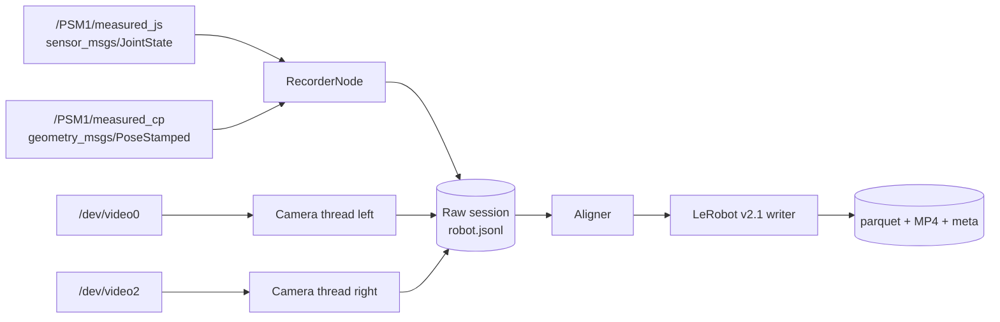
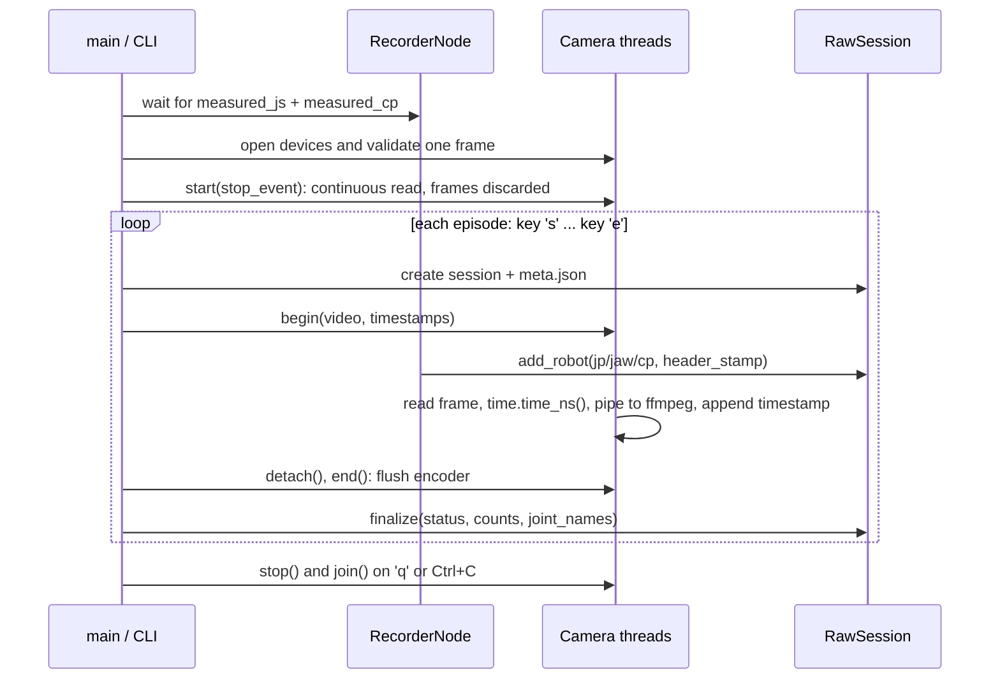

# Architecture

This document explains how the acquisition and export pipeline is organised,
why it is split into two stages, and how timestamps become a LeRobot Dataset
v2.1 episode.

## 1. Goals and non-goals

### Goals

- Record dVRK `measured_js` (joint positions) and `measured_cp` (Cartesian
  pose) from ROS 2 Humble.
- Record two V4L2 camera streams from `/dev/video0` and `/dev/video2`.
- Preserve enough timing information to align the streams offline.
- Export a self-contained LeRobot Dataset v2.1 with parquet, MP4, and metadata.
- Fail visibly: no silent topic substitution, resizing, or invented frames.
- Keep the ROS/OpenCV acquisition environment separate from the ML/training
  environment.

### Non-goals

- Teleoperation or robot control.
- Camera calibration, rectification, or hand-eye registration.
- Hardware trigger/genlock integration.
- Real-time LeRobot writing during acquisition.
- Uploading datasets to the Hugging Face Hub.
- Defining the final imitation-learning action semantics.

## 2. Why two stages

A direct-to-LeRobot recorder would couple three concerns that fail for
different reasons:

1. ROS message capture and camera I/O are real-time and hardware-dependent.
2. Timestamp alignment is a data-processing policy that should be tunable
   without re-collecting data.
3. LeRobot serialisation needs ffmpeg, parquet, and metadata bookkeeping.

The pipeline therefore writes an immutable **raw session** first and derives a
LeRobot dataset from it:



Benefits:

- Re-export with different tolerances or feature names without touching the
  robot.
- A crash during export cannot corrupt the raw data.
- Acquisition has a very small dependency surface: ROS 2, OpenCV, NumPy.
- The raw JSONL is easy to inspect and script against.

Cost:

- One extra lossy H.264 generation (raw CRF, then export CRF).
- The raw session is not a standard format; `acquire/session.py` defines it.

## 3. Component map

```text
src/dvrk_lerobot/
├── cli.py                     command dispatch only
├── config/
│   ├── model.py               frozen dataclasses
│   └── loader.py              YAML parsing and validation
├── acquire/
│   ├── camera.py              V4L2 capture thread + live H.264 encoder
│   ├── metadata.py            session naming, meta.json, camera checks
│   ├── node.py                ROS 2 subscriptions and callbacks
│   ├── recorder.py            warm-up and capture loop
│   └── session.py             append-only raw session + loader
├── align/
│   └── sync.py                stereo pairing and robot nearest-neighbour
├── dataset/
│   ├── schema.py              LeRobot feature names and path templates
│   ├── stats.py               numeric/video stats and pooled aggregation
│   ├── video.py               ffmpeg encode + ffprobe
│   ├── parquet.py             per-episode frame table
│   ├── metadata.py            meta/*.json and meta/*.jsonl
│   └── writer.py              export orchestration and atomic rename
└── tools/
    ├── doctor.py              pre-flight diagnostics
    └── verify.py              read-only dataset checks
```

Dependency direction:

```text
cli -> acquire, align, dataset, tools
acquire.recorder -> acquire.node, acquire.camera, acquire.session
align -> acquire.session, dataset.schema, config
dataset.writer -> align.sync, dataset.*, config
tools.verify -> dataset.schema, dataset.video
tools.doctor -> acquire.camera, config
```

There are no cycles. `acquire` does not import `dataset`; `dataset` does not
import ROS 2.

## 4. Process and threading model

During `record`:

```text
main thread
├── preview window (cv2.imshow, both eyes) + key poll (window or terminal)
├── s = begin episode, e = end episode, q = quit
├── ROS spin thread: SingleThreadedExecutor.spin()
├── camera thread: left  -> read() -> [episode active] ffmpeg stdin -> video/left.mkv
├── camera thread: right -> read() -> [episode active] ffmpeg stdin -> video/right.mkv
└── ROS subscriptions -> RecorderNode -> RawSession.add_robot() [episode active]
```

- Robot topics and cameras stay open for the whole run. Camera threads read
  continuously and discard frames between episodes, so the V4L2 queue never
  holds stale frames and the first frame of an episode has a correct timestamp.
- `s` creates a new raw session, attaches it to the ROS node, then attaches an
  encoder to each camera (`Camera.begin`). `e` detaches both cameras at once
  (`Camera.detach`), flushes the encoders (`Camera.end`), then detaches the
  node. Robot logging therefore brackets the video on both ends.
- Quitting during an episode (`q`, Ctrl+C, SIGTERM) finalises it as `aborted`;
  a camera or encoder error finalises it as `failed`.

- The ROS executor spins on its own thread, so drawing the preview never delays
  robot callbacks (about 600 messages/s for two arms). Callbacks are serialised
  by the single-threaded executor; `RecorderNode.attach()` swaps the active
  session under a lock, so an episode is never closed while a callback writes.
- HighGUI (`cv2.imshow` / `cv2.waitKey`) is only used from the main thread. The
  preview shows each camera's latest frame, scaled to 480 px high.
- Each camera owns one thread, one `cv2.VideoCapture`, and one `ffmpeg`
  subprocess (libx264 `veryfast`). Raw BGR frames are piped to ffmpeg from
  that thread; encoding runs in the ffmpeg process and never blocks the ROS
  callbacks.
- The main loop polls `camera.check()` and stops if a camera thread failed.
- `stop` is a `threading.Event` shared by the camera threads and the signal
  handler.
- Camera threads are daemon threads, but `Camera.stop()` joins them for up to
  60 seconds before releasing the device.
- `SIGTERM` sets the stop event; `Ctrl+C` raises `KeyboardInterrupt` in the
  main thread. Both paths reach the `finally` block that finalises any active
  episode.

During `convert` there is a single process and a single thread. Each camera side
is encoded sequentially to avoid competing ffmpeg processes.



The cameras write their videos and timestamp files directly; the `RawSession`
arrow is conceptual for the frame timestamps and counts.

## 5. Clocks and timestamps

There are three timestamp domains:

| Domain | Source | Used for |
|---|---|---|
| Wall clock | `time.time_ns()` | camera capture time, receive time, session start/end |
| ROS header stamp | `msg.header.stamp` | robot sample alignment time |
| Output timeline | `frame_index / fps` | LeRobot `timestamp` column |

The recorder writes both `t_ns` (receive) and `stamp_ns` (header) for every
robot sample. The aligner prefers `stamp_ns` and falls back to `t_ns` when the
header stamp is zero.

Assumptions:

- `use_sim_time` is false.
- Robot and camera clocks are the same system clock, or at least differ by a
  constant offset that is checked before collection.
- A header-stamp offset larger than two seconds is a configuration error; the
  recorder warns once per topic and `doctor` prints the measured offset.

### Why not interpolate

The aligner uses nearest-neighbour selection, not interpolation. This avoids
inventing joint states or poses that the robot never reported. The cost is that
the state is at most `robot_tolerance_ms` old relative to the stereo pair. The
exporter records the median joint/pose header skew in the alignment notes.

### Why the output timeline is synthetic

LeRobot requires a fixed-fps timeline. If raw capture is slightly irregular,
writing raw timestamps would fail LeRobot's timestamp check and make frame
indexing ambiguous. The exporter instead writes `k / fps` and keeps the true
capture times in the raw `*_timestamps.txt` files. The alignment notes warn when the raw
capture span differs from the nominal span by more than 10%.

## 6. Raw session format

A raw session is a directory:

```text
<root>/<run datetime>/episode_<N>/
├── meta.json
├── robot.jsonl
└── video/
    ├── left.mkv                # H.264, every captured frame in order
    ├── left_timestamps.txt     # one capture time (ns) per line; line i = frame i
    ├── right.mkv
    └── right_timestamps.txt
```

MKV is used because it stays readable if the recorder is killed. On load, the
timestamp list is truncated to the number of encoded frames, so a crash only
loses the frames still inside the encoder.

One `record` run creates `<root>/YYYYmmdd-HHMMSS/` at its first episode and
numbers episodes `episode_1`, `episode_2`, ... in start order (aborted episodes
keep their number). `session_id` in `meta.json` is `<run>/<episode>`. Export
accepts run directories and expands them in numeric episode order (so
`episode_10` follows `episode_9`).

### `meta.json`

Written initially and rewritten atomically at finalisation:

```json
{
  "format": "dvrk-raw-v2",
  "session_id": "20261027-140000/episode_1",
  "created_ns": 1761544800000000000,
  "ended_ns": 1761544860000000000,
  "task": "needle transfer",
  "notes": "",
  "fps": 30,
  "clock": "system",
  "status": "ok",
  "arms": [
    {"name": "PSM1", "js_topic": "/PSM1/measured_js", "cp_topic": "/PSM1/measured_cp",
     "jaw_topic": "/PSM1/jaw/measured_js"}
  ],
  "cameras": {
    "left": {"device": "/dev/video0", "width": 1920, "height": 1080, "fps": 30,
             "fourcc": "MJPG", "crf": 18, "negotiated": {}},
    "right": {"device": "/dev/video2", "width": 1920, "height": 1080, "fps": 30,
              "fourcc": "MJPG", "crf": 18, "negotiated": {}}
  },
  "frame_counts": {"left": 1800, "right": 1800},
  "robot_counts": {"jp": 6000, "jaw": 6000, "cp": 6000},
  "joint_names": {"PSM1": ["PSM1_1_joint", "..."]},
  "frame_ids": {"PSM1": "PSM1_base"}
}
```

`camera_info` in the final file contains the negotiated width, height, fps, and
fourcc. `joint_names` and `frame_ids` are captured from the first valid
messages and are the source of truth for the exported feature names.

### `robot.jsonl`

One JSON object per ROS message:

```json
{"t_ns":1761544800123456789,"stamp_ns":1761544800123000000,"kind":"jp","arm":"PSM1","values":[0.1,0.2,0.3,0.4,0.5,0.6,0.7]}
{"t_ns":1761544800133456789,"stamp_ns":1761544800133000000,"kind":"cp","arm":"PSM1","values":[0.01,0.02,0.03,0.0,0.0,0.0,1.0]}
```

Messages are appended in callback order. The loader validates:

- JSON shape and numeric types;
- `kind` is `jp`, `jaw`, or `cp`;
- `arm` is present in `meta.json`;
- frame timestamps are strictly increasing and filenames are integers.

A corrupt line aborts the load with a file and line number. It is not silently
skipped.

### Why separate JP and CP lines

`measured_js` and `measured_cp` are independent topics with independent rates
and header stamps. Storing them as separate events preserves each message's
original timestamp. The aligner builds one time series per `(arm, kind)` and
independently selects the nearest sample for each output frame.

## 7. Alignment algorithm

Given a raw session:

1. Build sorted `(stamp, values)` series for every `(arm, jp)`, `(arm, jaw)`, and `(arm, cp)`.
   Duplicate stamps collapse to the first sample.
2. Pair frames:

```text
j = 0
for each left frame L:
    while j < len(right) and right[j].ts < L.ts - stereo_tol:
        j += 1
    choose j or j+1, whichever is closer to L.ts
    if |chosen.ts - L.ts| <= stereo_tol:
        emit pair (L, chosen)
        j = chosen + 1
```

Left is the master. Each right frame is used at most once.

3. For each pair, compute `t = (L.ts + R.ts) // 2`.
4. For each arm, find the nearest `jp`, `jaw`, and `cp` timestamps to `t` within
   `robot_tolerance_ms`. If any is missing, drop the pair and count it.
5. Concatenate the selected values in configuration order to form the state.
6. Set `timestamp[k] = k / fps`.
7. Set `action[t] = state[t + 1]`, with the final action repeated.

The result is an `Episode`:

```python
Episode(
    session=Path,
    task=str,
    state=np.ndarray,       # (N, D), float32
    action=np.ndarray,      # (N, D), float32
    timestamps=np.ndarray,  # (N,), float32, k/fps
    videos=dict[str, Path], # raw left/right MKV
    left=list[int],         # N frame indices into videos["left"]
    right=list[int],        # N frame indices into videos["right"]
    state_names=list[str],  # D names
    notes=list[str],
)
```

### State-vector definition

For arms `A1, A2, ...`:

```text
A1.jp.<joint name 0> ... A1.jp.<joint name n>
A1.jaw
A1.cp.x, A1.cp.y, A1.cp.z, A1.cp.qx, A1.cp.qy, A1.cp.qz, A1.cp.qw
A2.jp....
A2.jaw
A2.cp....
```

`observation.state` and `action` share this dimension and these names. The
exporter rejects episodes with different names, which prevents a silently
reordered vector when the arm configuration changes between sessions.

## 8. LeRobot v2.1 mapping

### Features

| Feature | dtype | Shape | Storage |
|---|---|---|---|
| `observation.state` | `float32` | `[D]` | fixed-size list in parquet |
| `action` | `float32` | `[D]` | fixed-size list in parquet |
| `observation.images.left` | `video` | `[H,W,3]` | MP4 |
| `observation.images.right` | `video` | `[H,W,3]` | MP4 |
| `timestamp` | `float32` | `[1]` | scalar |
| `frame_index` | `int64` | `[1]` | scalar |
| `episode_index` | `int64` | `[1]` | scalar |
| `index` | `int64` | `[1]` | scalar |
| `task_index` | `int64` | `[1]` | scalar |

The default features are appended after the user features, matching LeRobot's
`{**features, **DEFAULT_FEATURES}` construction.

### Episode table

Column order:

```text
observation.state, action, timestamp, frame_index,
episode_index, index, task_index
```

`frame_index` restarts at zero for each episode. `index` is global and
contiguous across episodes. `episode_index` is the input order. `task_index`
comes from the first-seen task string.

### Videos

Each episode is encoded independently:

```text
<raw MKV, selected frames decoded by OpenCV> | ffmpeg -f rawvideo -i - \
       -c:v libx264 -preset <preset> -crf <crf> \
       -pix_fmt yuv420p -movflags +faststart \
       videos/.../episode_XXXXXX.mp4
```

The raw video is decoded sequentially and only the aligned frame indices are
piped to the encoder, so frames dropped by alignment are skipped. After encoding, `ffprobe` supplies the actual
dimensions, codec, pixel format, and frame rate. The feature schema uses those
probed values.

`yuv420p` requires even width and height; the config loader rejects odd sizes.

### Metadata files

| File | Content |
|---|---|
| `meta/info.json` | version, fps, totals, path templates, feature schema |
| `meta/episodes.jsonl` | `{episode_index, tasks, length}` |
| `meta/tasks.jsonl` | `{task_index, task}` |
| `meta/episodes_stats.jsonl` | `{episode_index, stats}` for every feature |
| `meta/stats.json` | pooled dataset-level stats |

Stats follow LeRobot's definitions:

- Numeric vectors: min/max/mean/std over frames, `count = N`.
- Videos: per-channel min/max/mean/std in `[0,1]`, shape `(3,1,1)`, computed
  from sampled frames; `count` is the number of sampled frames.
- Pooling uses weighted means and the parallel variance formula:
  `var = sum((var_i + (mean_i - mean)^2) * n_i) / sum(n_i)`.

`meta/stats.json` is retained for compatibility even though v2.1 readers can
reconstruct dataset stats from `episodes_stats.jsonl`.

### Atomicity

The exporter:

1. Refuses an existing output path.
2. Creates `<output>.partial`.
3. Writes videos, parquet, and metadata.
4. Renames `<output>.partial` to `<output>` with `os.replace`.

A failed export leaves the partial tree in place. It never deletes or reuses a
user directory.

## 9. Error handling and invariants

### Acquisition invariants

- A session directory is created only after all topics are warm.
- One session has exactly two camera directories.
- Camera resolution must match the requested configuration; no resize.
- Both cameras must negotiate the same resolution and rate.
- A zero header stamp falls back to receive time, with a warning.
- A camera thread failure aborts the session.

### Alignment invariants

- At least two stereo pairs are required.
- Every pair must have `jp`, `jaw`, and `cp` for every configured arm.
- `jaw/measured_js` must have exactly one value.
- `measured_cp` must have exactly seven values.
- State values must be finite.
- All episodes must share the same state names and dimension.

### Export invariants

- Output path does not exist.
- `observation.state` and `action` are fixed-size float32 lists.
- `frame_index`, `index`, and `episode_index` are contiguous and consistent.
- Every referenced MP4 exists and matches the feature dimensions.
- `total_frames`, `total_episodes`, `total_tasks`, and `total_videos` match the
  files on disk.

## 10. Failure modes and recovery

| Failure | Detection | Recovery |
|---|---|---|
| Topic missing | warm-up timeout / `doctor` | start dVRK, fix YAML |
| Camera busy | `Camera.open` | close other process, fix permissions |
| Camera unplugged mid-session | `Camera.check` | session marked `failed`; raw frames kept |
| Disk full | write or encode error | free space, re-record or re-export |
| ffmpeg missing / no x264 | export error | install ffmpeg |
| Corrupt JSONL | load error with line number | fix or discard session |
| Export interrupted | `.partial` directory | inspect, remove, re-export |
| Session status not `ok` | export refusal | inspect session, use `--allow-incomplete` if valid |
| Output exists | export refusal | choose a new path |

## 11. Performance and capacity

### Acquisition

Measured on the lab machine (UGREEN capture cards, 1920x1080, libx264
`veryfast`, CRF 18):

- About 9 MB/s per eye (about 65 GB per hour for stereo), versus about
  23 MB/s per eye for JPEG quality 95. CRF 23 is roughly 2.5x smaller again.
- Each ffmpeg encoder uses about 1.7 CPU cores; both eyes sustain 30 fps.

The recorder does not buffer frames in memory. Each frame is piped to ffmpeg
before the next `read()`, which applies natural back-pressure. If the encoder
cannot keep up, the V4L2 driver drops frames and the exporter's span check
reports the mismatch.

### Export

- H.264 CRF 18 is typically 1-5 MB/s for endoscopic video.
- Parquet is small (state vectors only).
- Video encoding is the bottleneck; export of a few minutes is fast, a
  one-hour dataset may take tens of minutes depending on CPU and preset.
- Export is single-process and sequential by design; this keeps memory bounded
  and avoids overloading the machine.

## 12. Extension points

### Add an arm

Uncomment/add the arm block in `configs/record.yaml`. The state vector grows by
`len(measured_js.position) + 7`. Every session in a dataset must use the same
configuration.

### Add a camera

The current v2.1 schema and writer assume exactly `left` and `right`. Adding a
third view requires:

1. Extending `SIDES` and camera parsing.
2. Encoding the extra video in `dataset/writer.py`.
3. Adding the feature and stats.
4. Updating tests and the info schema.

This is intentionally explicit rather than looping over arbitrary camera keys.

### Change the action source

The clean extension is a new raw stream, for example:

```text
/PSM1/servo_jp  ->  {"kind": "action_jp", ...}
```

Then:

1. Subscribe in `RecorderNode`.
2. Add a `kind` to the JSONL schema and parser.
3. Build `action` from the aligned `action_jp` stream in `align/sync.py`.
4. Keep the next-state fallback only for legacy sessions.

Do not silently reinterpret `measured_js` as the command; that would erase the
distinction between measured and commanded motion.

### Lossless intermediates

Use `-crf 0` (lossless H.264) or switch the codec in `dataset/video.py:start_encoder`
to FFV1. The aligner only needs frame indices and timestamps, so nothing else
changes.

### Hardware trigger

If the cameras share a trigger, the capture timestamp should come from the
trigger/driver, not `time.time_ns()`. The raw schema already supports integer
nanoseconds; the aligner does not need a format change.

### Rosbag2 coexistence

Record a rosbag2 in parallel for full-graph replay. The raw session remains the
compact source for the LeRobot export.

## 13. Alternatives considered

### Direct `LeRobotDataset` recording

Rejected for the acquisition stage because:

- It pulls PyTorch and the full LeRobot stack into the ROS environment.
- It writes temporary PNGs per frame before encoding, adding significant I/O.
- Re-alignment requires re-recording.
- A crash can leave a half-written dataset.

The custom writer is deliberately small and pinned to v2.1. The trade-off is
that format changes must be maintained here.

### rosbag2 as the only raw format

Rosbag2 would preserve the full graph, but:

- Extracting and aligning two V4L2 streams still needs custom code.
- Bags are larger and less convenient for frame-level inspection.
- Re-export requires a ROS environment.

The raw session is a purpose-built, minimal analogue. Rosbag2 can be added in
parallel when full replay is needed.

### Per-frame JPEG files during acquisition

Used in the first version, then replaced by live H.264 because 1080p stereo
JPEGs cost about 160 GB per hour. The original concerns about online encoding
are handled as follows:

- Encoders run in separate ffmpeg processes; they use about 1.7 cores each on
  the lab machine and do not slow down capture or the ROS callbacks.
- Timestamp-to-frame mapping is explicit: line i of `<side>_timestamps.txt` is
  frame i, and ffmpeg runs with `-vsync passthrough` so it never drops or
  duplicates frames.
- MKV survives a killed recorder; only frames still buffered in the encoder are
  lost.

## 14. Verification strategy

1. **Unit tests** cover config validation, raw session invariants, pairing,
   nearest-neighbour selection, state construction, and pooled statistics.
2. **Integration test** builds two synthetic sessions, encodes real MP4s with
   ffmpeg, exports, and runs the structural verifier.
3. **`verify` command** checks a real dataset's metadata, parquet, and video
   dimensions.
4. **LeRobot smoke test** in the training environment loads the dataset and
   decodes a sample. This is the final compatibility gate because it exercises
   the exact LeRobot version used downstream.

The repository does not vendor LeRobot. The synthetic export was loaded with
`lerobot==0.3.3` (CPU Torch, PyAV decoder) during development, and every sample
and both video streams decoded. The training environment remains the authority
on loader compatibility for other versions.
